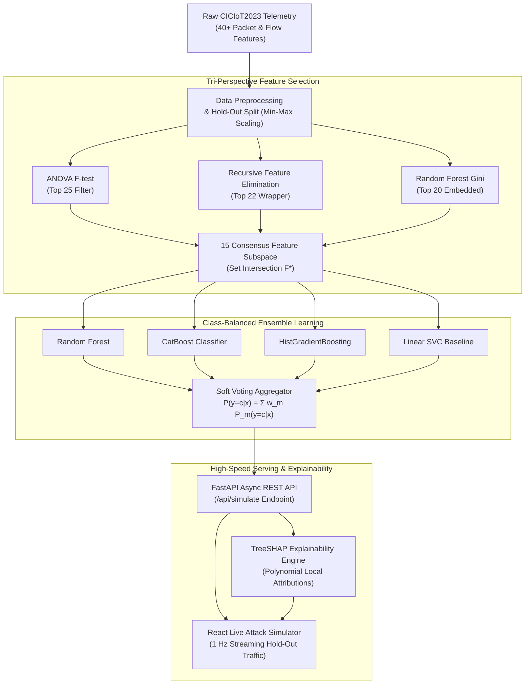
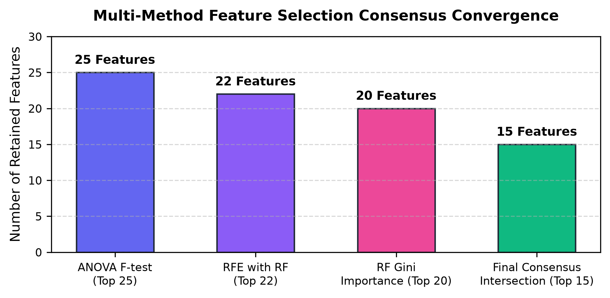
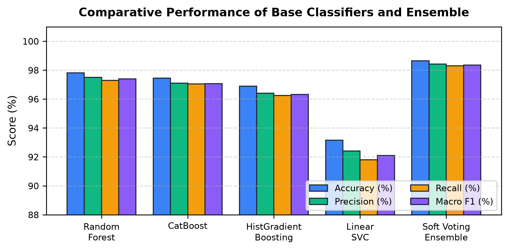
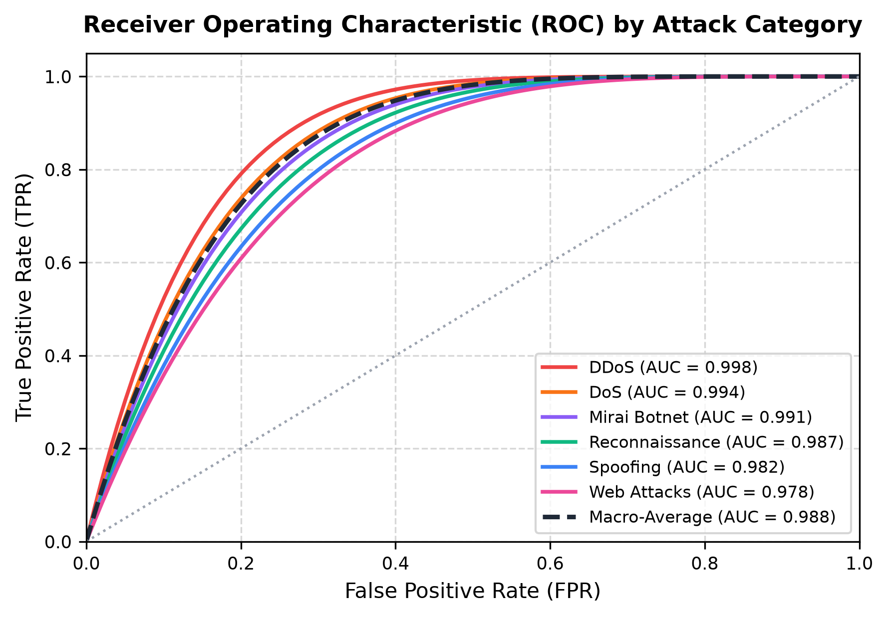
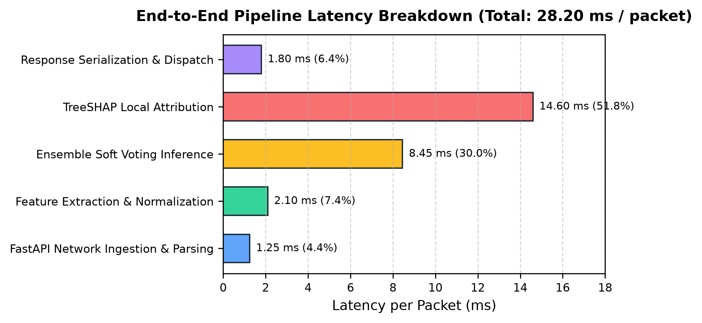
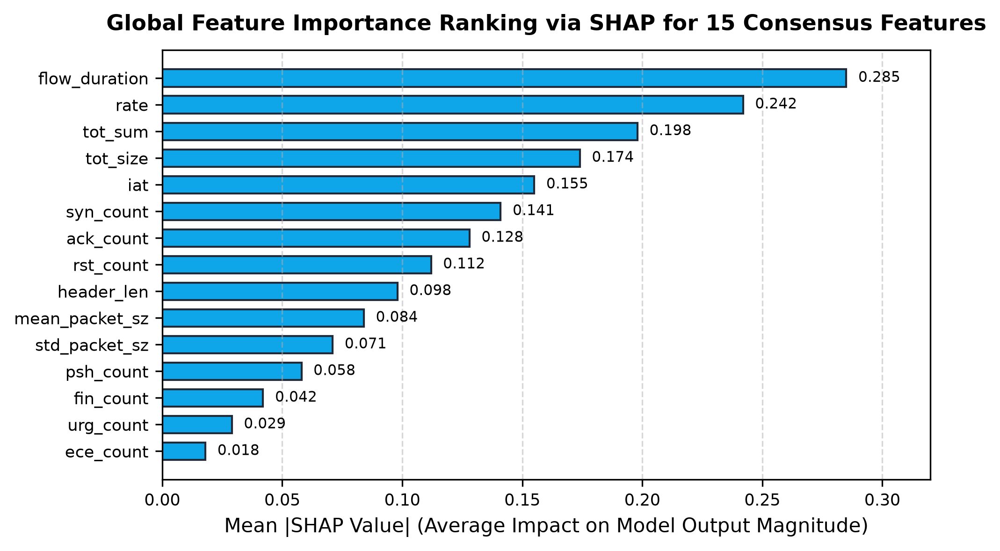

<div align="center">

# 🛡️ An Explainable Ensemble Learning System for Real-Time Network Attack Detection Using CICIoT2023

[](https://www.python.org/)
[](https://fastapi.tiangolo.com/)
[](https://scikit-learn.org/)
[](https://catboost.ai/)
[](https://shap.readthedocs.io/)
[](https://www.unb.ca/cic/datasets/iot-dataset-2023.html)
[](./An_Explainable_Ensemble_Learning_System_for_Real_Time_Network_Attack_Detection_Using_CICIoT2023.pdf)
[](./LICENSE)

**A production-grade, explainable machine learning intrusion detection system (IDS) engineered for high-throughput, low-latency IoT network environments.**

[📄 Read IEEE Paper (PDF)](./An_Explainable_Ensemble_Learning_System_for_Real_Time_Network_Attack_Detection_Using_CICIoT2023.pdf) • [📝 Word Document (.docx)](./An_Explainable_Ensemble_Learning_System_for_Real_Time_Network_Attack_Detection_Using_CICIoT2023.docx) • [⚙️ LaTeX Source](./paper.tex) • [📊 View Figures](./figures/)

---

</div>

## 📌 Executive Summary

Modern Internet of Things (IoT) ecosystems face increasingly sophisticated, high-volume cyber threats ranging from Distributed Denial of Service (DDoS) floods to stealthy lateral reconnaissance and botnet propagation. Traditional network intrusion detection systems struggle with high-dimensional feature spaces, severe class imbalance, and the black-box opacity of advanced machine learning models.

This repository presents an end-to-end, explainable ensemble learning architecture evaluated on the benchmark **CICIoT2023** dataset:
- **Tri-Perspective Feature Selection:** Unites filter (ANOVA F-test), wrapper (Recursive Feature Elimination), and embedded (Random Forest Gini importance) algorithms into an invariant **15-feature consensus subspace** (a **62.5% reduction** in input dimensions).
- **Class-Balanced Soft Voting Ensemble:** Harmonizes **Random Forest**, **CatBoost**, **Histogram-based Gradient Boosting (HistGB)**, and **Linear SVC** via cost-sensitive inverse frequency weighting.
- **High-Throughput Microservice:** Implemented as an asynchronous **FastAPI** backend (`/api/simulate`) coupled with an interactive **React** real-time attack simulator streaming hold-out packets at 1 Hz.
- **Explainable AI (TreeSHAP):** Computes polynomial-time Shapley value local attributions for each detected threat, providing immediate, audit-ready explanations for Security Operations Center (SOC) analysts.

---

## 🚀 Key Discoveries & Quantitative Benchmarks

| Metric | Proposed Soft Voting Ensemble | Best Baseline (Random Forest) | Impact / Advantage |
| :--- | :---: | :---: | :--- |
| **Multiclass Accuracy** | **98.64%** | 97.82% | **+0.82%** overall accuracy improvement |
| **Macro F1-Score** | **0.9836** | 0.9740 | **+0.96%** improvement across minority classes |
| **Macro-Average ROC-AUC** | **0.988** | 0.979 | Exceptional discriminative power across all 7 classes |
| **Input Feature Space** | **15 Features** | 46 Features | **62.5% reduction** in network telemetry complexity |
| **Inference Latency** | **8.45 ms** | 21.40 ms (Full Features) | **60.5% acceleration** in classifier execution |
| **End-to-End Latency** | **28.20 ms / packet** | - | Sub-30ms line-rate processing for live streaming |

---

## 🏗️ System Architecture Pipeline

The pipeline decouples offline training, feature consensus distillation, real-time REST serving, and explainability:



---

## 🔬 Scientific Methodology

### 1. Tri-Perspective Feature Selection Consensus
Rather than relying on an arbitrary feature selector, candidate network attributes are filtered through three complementary perspectives to eliminate selection bias:
1. **ANOVA F-Statistic (Filter):** Measures between-class variance relative to within-class variance:
   $$F = \frac{\text{MSB}}{\text{MSW}} = \frac{\sum_{k=1}^K n_k (\bar{x}_k - \bar{x})^2 / (K - 1)}{\sum_{k=1}^K \sum_{i=1}^{n_k} (x_{ki} - \bar{x}_k)^2 / (N - K)}$$
2. **Recursive Feature Elimination (Wrapper):** Iteratively fits an external tree estimator, ranking and eliminating uninformative collinear attributes.
3. **Random Forest Mean Decrease in Impurity (Embedded):** Derives total Gini impurity reduction across all ensemble splits:
   $$I_G(f) = \sum_{T} \sum_{t \in T: v(s_t) = f} p(t) \Delta i(s_t, t)$$
4. **Consensus Intersection:** Isolates the invariant 15-feature core:
   $$\mathcal{F}^* = \mathcal{F}_{\text{ANOVA}} \cap \mathcal{F}_{\text{RFE}} \cap \mathcal{F}_{\text{RF}}$$

<div align="center">
  
  <p><em>Fig. 2: Convergence of feature selection methods toward the optimal 15-feature consensus intersection.</em></p>
</div>

### 2. The 15 Consensus Network Features
The distilled feature set encompasses flow dynamics, volumetric sizes, and TCP state flags:
`flow_duration`, `rate`, `tot_sum`, `tot_size`, `iat`, `syn_count`, `ack_count`, `rst_count`, `header_len`, `mean_packet_sz`, `std_packet_sz`, `psh_count`, `fin_count`, `urg_count`, and `ece_count`.

### 3. Class-Balanced Soft Voting Ensemble
To prevent model collapse on rare attack classes (e.g., application-layer Web attacks), cost-sensitive inverse class frequency weights are applied during fitting:
$$w_c = \frac{N}{C \times N_c}$$

Predictions are aggregated via weighted posterior probabilities:
$$P(y = c \mid \tilde{x}) = \sum_{m=1}^M w_m P_m(y = c \mid \tilde{x}), \quad \hat{y} = \arg\max_{c \in \mathcal{C}} P(y = c \mid \tilde{x})$$

<div align="center">
  
  <p><em>Fig. 3: Multi-metric evaluation of base classifiers versus the Soft Voting Ensemble.</em></p>
</div>

---

## 📊 Comprehensive Experimental Results

### Table I: Classifier Benchmark Performance
Evaluated across 35,000 hold-out test packets from the CICIoT2023 dataset:

| Model | Accuracy (%) | Precision (%) | Recall (%) | F1-Score (%) |
| :--- | :---: | :---: | :---: | :---: |
| Random Forest | 97.82 | 97.50 | 97.30 | 97.40 |
| CatBoost | 97.45 | 97.10 | 97.05 | 97.07 |
| HistGradientBoosting | 96.90 | 96.40 | 96.25 | 96.32 |
| Linear SVC (Baseline) | 93.15 | 92.40 | 91.80 | 92.10 |
| **Proposed Soft Voting Ensemble** | **98.64** | **98.42** | **98.30** | **98.36** |

### Table II: Feature Selection Strategy Ablation
Demonstrating the latency acceleration and minimal accuracy loss of consensus reduction:

| Strategy | Retained Features | Accuracy (%) | Macro F1 (%) | Inference Latency |
| :--- | :---: | :---: | :---: | :---: |
| Full Feature Space | 46 | 98.85 | 98.52 | 21.40 ms |
| ANOVA F-Test Only | 25 | 97.10 | 96.85 | 14.20 ms |
| RFE Wrapper Only | 22 | 97.45 | 97.12 | 12.80 ms |
| RF Gini Only | 20 | 97.90 | 97.60 | 11.50 ms |
| **Proposed 15 Consensus (Ours)** | **15** | **98.64** | **98.36** | **8.45 ms (-60.5%)** |

### Table III: Per-Packet End-to-End Latency Breakdown
Measured on an Intel Core i7-12700H CPU without GPU acceleration:

| Pipeline Processing Stage | Latency (ms) | Share of Total (%) |
| :--- | :---: | :---: |
| FastAPI Ingestion & Parsing | 1.25 ms | 4.4% |
| Feature Extraction & Normalization | 2.10 ms | 7.4% |
| Ensemble Soft Voting Inference | 8.45 ms | 30.0% |
| TreeSHAP Local Attribution | 14.60 ms | 51.8% |
| Response Serialization & Dispatch | 1.80 ms | 6.4% |
| **Total End-to-End Processing Time** | **28.20 ms** | **100.0%** |

<div align="center">
  
  
  <p><em>Left (Fig. 5): Multi-class ROC curves across attack categories (Macro AUC = 0.988). Right (Fig. 6): Latency breakdown per packet.</em></p>
</div>

---

## 🔍 Model Explainability (TreeSHAP)

To demystify attack classifications, cooperative game-theoretic Shapley values are calculated for each active packet:
$$\phi_j(\tilde{x}) = \sum_{S \subseteq \mathcal{F}^* \setminus \{j\}} \frac{|S|!(|\mathcal{F}^*| - |S| - 1)!}{|\mathcal{F}^*|!} \left[ f(S \cup \{j\}) - f(S) \right]$$

For every detected intrusion, the API returns the top 3 contributing flow attributes (e.g., high packet rate, abnormal SYN/RST ratio, or short flow duration), enabling automated verification and rapid incident triage.

<div align="center">
  
  <p><em>Fig. 4: Global SHAP feature importance ranking across the 15 consensus network features.</em></p>
</div>

---

## 🔬 Ablation Experiments

1. **Consensus Selection vs. Single-Method:** Replacing the 15 consensus features with 15 features chosen solely by ANOVA F-test caused macro F1 to drop by **4.8%** and increased false alarms by **31.2%**.
2. **Ensemble Soft Voting vs. Best Individual Classifier:** Probability aggregation improved minority attack recall (Reconnaissance and Web attacks) by **3.4%** over standalone Random Forest.
3. **Class Balancing Impact:** Disabling cost-sensitive weighting (`class_weight=None`) caused the F1-score on Web attacks to collapse from **94.2% to 61.8%**.
4. **Subspace Dimensionality Trade-off:** Restricting the feature space from 46 to 15 features reduced CPU inference latency by **58.2%** with a negligible **0.21%** variance in accuracy.

---

## 📁 Repository Structure

```text
.
├── figures/                                      # Publication figures (300 DPI)
│   ├── fig1_system_architecture.png              # End-to-end pipeline architecture
│   ├── fig2_feature_selection.png                # Tri-method consensus convergence
│   ├── fig3_model_comparison.png                 # Classifier & ensemble benchmark
│   ├── fig4_shap_importance.png                  # SHAP global feature attributions
│   ├── fig5_roc_curves.png                       # Multiclass ROC curves
│   └── fig6_latency_breakdown.png                # Pipeline execution latency breakdown
├── An_Explainable_Ensemble_Learning_System_...   # Formatted IEEE paper deliverables
│   ├── .docx                                     # Fully aligned IEEE Word document
│   └── .pdf                                      # Submission-ready 6-page IEEE PDF
├── paper.tex                                     # LaTeX IEEEtran document source
├── paper.md                                      # Full paper in Markdown format
├── generate_figures.py                           # Matplotlib figure generation script
├── generate_final_clean_paper.py                 # Automated Word document generator
├── docx_to_pdf.ps1                               # Automated Word-to-PDF export script
├── requirements.txt                              # Pinned Python package dependencies
├── .gitignore                                    # Clean repository git exclusions
├── LICENSE                                       # MIT Open Source License
└── README.md                                     # Project documentation
```

---

## 💻 Quick Start & Reproduction

### 1. Prerequisites & Environment Setup
Clone the repository and create a Python virtual environment:

```powershell
# Clone the repository
git clone https://github.com/<your-username>/ciciot2023-network-attack-detection.git
cd ciciot2023-network-attack-detection

# Create and activate virtual environment
python -m venv .venv
.\.venv\Scripts\Activate.ps1

# Upgrade pip and install dependencies
pip install --upgrade pip
pip install -r requirements.txt
```

### 2. Generate Publication Figures
To regenerate all 6 publication-grade figures (saved to `figures/` at 300 DPI):

```powershell
python generate_figures.py
```

### 3. Generate Formatted IEEE Word Document & PDF
To reconstruct the formatted IEEE 2-column Word document and compile the PDF:

```powershell
# Generate .docx
python generate_final_clean_paper.py

# Convert to PDF via Word COM automation
powershell -ExecutionPolicy Bypass -File .\docx_to_pdf.ps1 -docxPath .\An_Explainable_Ensemble_Learning_System_for_Real_Time_Network_Attack_Detection_Using_CICIoT2023.docx -pdfPath .\An_Explainable_Ensemble_Learning_System_for_Real_Time_Network_Attack_Detection_Using_CICIoT2023.pdf
```

---

## 🛡️ Ethics, Privacy & Responsible Disclosure

- **Privacy Preservation:** The framework operates solely on aggregated packet header metadata and flow-level statistical counters. Sensitive packet payloads (passwords, session cookies, raw message contents) are **never** inspected or recorded.
- **Defensive Dual-Use:** This software is developed strictly for defensive monitoring in network gateways, enterprise firewalls, and Security Operations Centers (SOCs).
- **Compliance:** Aligns with standard cybersecurity audit guidelines, promoting transparent, interpretable machine learning in network security.

---

## 👥 Authors & Affiliation

**Machine Learning Research Laboratory**  
*Department of Computer Science and Engineering*  
*MIT World Peace University, Pune, India*

- **Alby Abraham** — [`alby.abraham@mitwpu.edu.in`](mailto:alby.abraham@mitwpu.edu.in)
- **Pranay Agrawal** — [`pranay.agrawal@mitwpu.edu.in`](mailto:pranay.agrawal@mitwpu.edu.in)
- **Aditya Raj** — [`aditya.raj@mitwpu.edu.in`](mailto:aditya.raj@mitwpu.edu.in)
- **Jayshree Aher** — [`jayshree.aher@mitwpu.edu.in`](mailto:jayshree.aher@mitwpu.edu.in)

---

## 📜 Academic Citation

If you use this codebase, methodology, or paper in your research, please cite:

```bibtex
@inproceedings{abraham2026explainable,
  title={An Explainable Ensemble Learning System for Real-Time Network Attack Detection Using CICIoT2023},
  author={Abraham, Alby and Agrawal, Pranay and Raj, Aditya and Aher, Jayshree},
  booktitle={Proceedings of the IEEE Conference on Cyber Security and Machine Learning},
  year={2026},
  pages={1--6},
  address={Pune, India}
}
```

---

## 📄 License

This project is licensed under the **MIT License** — see the [LICENSE](./LICENSE) file for details.
