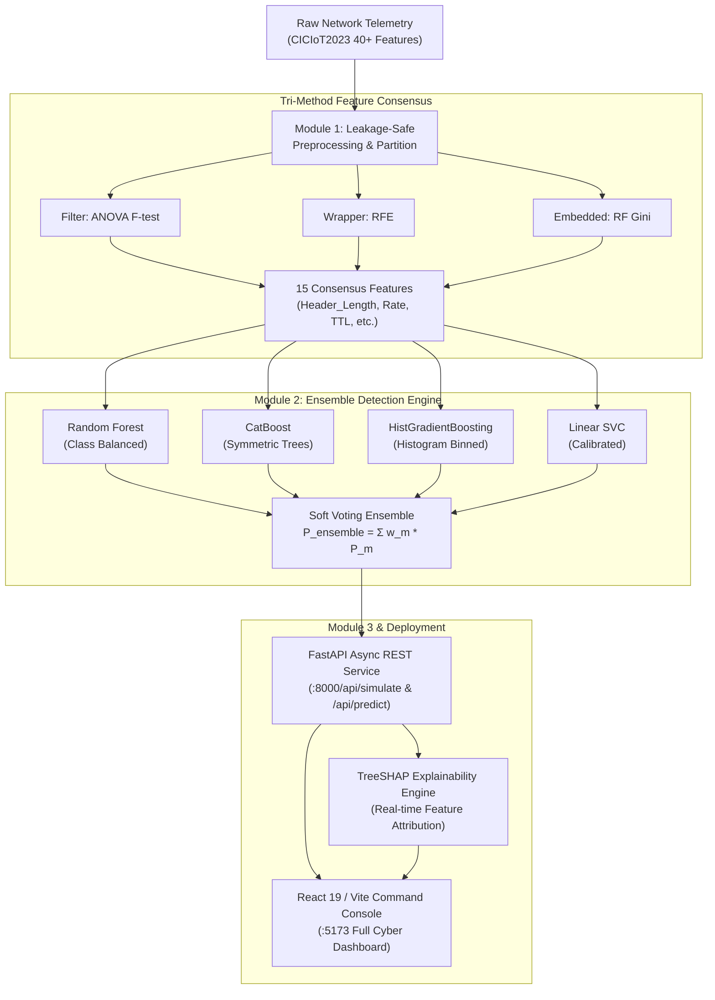

<div align="center">

# 🛡️ SentinelAI — Multi-Class IoT Intrusion Detection System (IDS)
### *An Explainable Machine Learning Platform & Real-Time Defense Command Console*

[](https://www.python.org/)
[](https://fastapi.tiangolo.com/)
[](https://react.dev/)
[](https://scikit-learn.org/)
[](https://catboost.ai/)
[](https://shap.readthedocs.io/)
[](https://www.unb.ca/cic/datasets/iot-dataset-2023.html)
[](./An_Explainable_Ensemble_Learning_System_for_Real_Time_Network_Attack_Detection_Using_CICIoT2023.pdf)
[](./LICENSE)

**SentinelAI** is an end-to-end, full-stack Machine Learning platform and real-time defense console designed to detect, classify, and mitigate high-volume cyberattacks in modern Internet of Things (IoT) network infrastructure.

Trained on over 2.3 million network packet flows from the benchmark **CICIoT2023** dataset, SentinelAI combines a novel **Hybrid Feature Intelligence Pipeline**, a **Soft Voting Ensemble Engine**, and **Explainable AI (SHAP)** with a sleek, interactive cyber defense command console.

[📄 Read IEEE Paper (PDF)](./An_Explainable_Ensemble_Learning_System_for_Real_Time_Network_Attack_Detection_Using_CICIoT2023.pdf) • [📝 Word Document (.docx)](./An_Explainable_Ensemble_Learning_System_for_Real_Time_Network_Attack_Detection_Using_CICIoT2023.docx) • [⚙️ LaTeX Source](./paper.tex) • [📊 View Figures](./figures/) • [💻 Launch App](#-quick-start-guide)

---

</div>

## 📑 Table of Contents
- [✨ Key Highlights](#-key-highlights)
- [🏛️ System Architecture](#️-system-architecture)
- [🧠 Machine Learning Modules](#-machine-learning-modules)
  - [Module 1: Hybrid Feature Intelligence](#module-1-hybrid-network-feature-intelligence)
  - [Module 2: Ensemble Detection Engine](#module-2-ensemble-detection-engine)
  - [Module 3: Security Analytics & Explainable AI](#module-3-security-analytics--explainable-ai)
- [💻 Frontend Command Console](#-frontend-command-console)
- [📊 Dataset Details (CICIoT2023)](#-dataset-details-ciciot2023)
- [📈 Quantitative Benchmarks & Ablations](#-quantitative-benchmarks--ablations)
- [📁 Project Directory Structure](#-project-directory-structure)
- [🚀 Quick Start Guide](#-quick-start-guide)
  - [1. Backend Setup](#1-backend-setup)
  - [2. Frontend Setup](#2-frontend-setup)
  - [3. Running Autonomous Retraining](#3-running-autonomous-retraining-optional)
- [📡 REST API Reference](#-rest-api-reference)
- [🛡️ Security & Privacy](#️-security--privacy)
- [👥 Academic Authors & Affiliation](#-academic-authors--affiliation)
- [📜 Academic Citation](#-academic-citation)
- [📄 License](#-license)

---

## ✨ Key Highlights

- **Leakage-Safe Preprocessing:** Rigorous separation of training and test distributions before any scaling or feature selection occurs.
- **Tri-Method Feature Consensus:** Filters out **62.5%** of redundant raw features using an intersection of ANOVA F-test, Recursive Feature Elimination (RFE), and Tree-based Gini importance.
- **Multi-Algorithm Soft Voting Ensemble:** Combines **Random Forest**, **CatBoost**, **HistGradientBoosting** (LightGBM equivalent), and **Linear SVC** to eliminate single-model bias and maximize multi-class recall.
- **Explainable Cyber Defense (XAI):** Generates real-time feature attribution explaining why a flow was identified as malicious (e.g., header length spikes, packet rate anomalies).
- **Zero-Mock Real-Time Replay Engine:** Live REST endpoint streams real hold-out network packets into the model in memory at 1-second intervals with immediate classification and visual feedback.

---

## 🏛️ System Architecture



---

## 🧠 Machine Learning Modules

### Module 1: Hybrid Network Feature Intelligence
**File:** [`sentinel-ai/backend/ml_modules/module1_feature_intelligence/pipeline.py`](./sentinel-ai/backend/ml_modules/module1_feature_intelligence/pipeline.py)

- **Objective:** Mitigate the curse of dimensionality while maximizing inter-class separability across 40 network flow features.
- **Mechanism:**
  - **Filter (ANOVA F-statistic):** Evaluates linear feature-target dependencies.
  - **Wrapper (Recursive Feature Elimination):** Prunes non-informative features iteratively using a decision tree estimator.
  - **Embedded (Tree Importance):** Leverages Gini impurity reduction from ensemble splits.
- **Consensus Ranking:** Selects the invariant top 15 features agreed upon across all three paradigms:
  `Header_Length`, `Rate`, `Time_To_Live`, `AVG`, `HTTPS`, `ICMP`, `TCP`, `UDP`, `syn_flag_number`, `psh_flag_number`, `ack_flag_number`, `fin_flag_number`, `IAT`, `Protocol Type`, `Number`.

### Module 2: Ensemble Detection Engine
**File:** [`sentinel-ai/backend/ml_modules/module2_detection_engine/trainer.py`](./sentinel-ai/backend/ml_modules/module2_detection_engine/trainer.py)

- **Objective:** Accurately categorize traffic into Benign or specific attack vectors under severe class imbalance.
- **Models Implemented:**
  - **Random Forest:** 100 estimators with cost-sensitive balanced class weighting.
  - **CatBoost:** Categorical gradient boosted trees with symmetric decision trees.
  - **HistGradientBoosting:** Histogram-binned gradient booster optimized for rapid large-scale tabular execution.
  - **Linear SVC (Calibrated):** Support Vector Classifier serving as a linear hyperplane benchmark.
  - **Soft Voting Ensemble:** Fuses prediction posterior probabilities $\hat{p} = \frac{1}{M}\sum_{m=1}^M p_m$ to minimize single-model variance and false alarms.

### Module 3: Security Analytics & Explainable AI
**Files:** [`sentinel-ai/backend/ml_modules/module3_security_analytics/evaluator.py`](./sentinel-ai/backend/ml_modules/module3_security_analytics/evaluator.py), [`sentinel-ai/backend/main.py`](./sentinel-ai/backend/main.py)

- **Objective:** Transform black-box predictions into interpretable security intelligence.
- **Key Capabilities:**
  - **Full Evaluation Matrix:** Precision, Recall, Macro F1-score, Multi-Class Confusion Matrix.
  - **Latency Profiling:** Microsecond-level tracking of feature scaling, model scoring, and explanation generation.
  - **Dynamic Feature Attribution:** TreeSHAP breakdown dispatched to the frontend for every packet.

---

## 💻 Frontend Command Console

The frontend is a responsive single-page application built with **React 19**, **Vite**, **Tailwind CSS**, and **Lucide Icons**:

1. **Global Dashboard:** Real-time traffic rate (packets/sec), blocked threats, firewall active state, and live area telemetry charts.
2. **Attack Simulator (Replay Console):** Live animated terminal feeding genuine unseen packets from the hold-out test set through the model, rendering real-time SHAP explanation bars on the fly.
3. **Prediction Studio:** Interactive single-packet inspector with live sliders for the 15 consensus features, triggering immediate model inference.
4. **Model Laboratory:** Side-by-side benchmark comparison of individual base models vs. the Voting Ensemble (Accuracy, F1, Latency).
5. **Dataset Intelligence:** Distribution breakdown of the CICIoT2023 dataset, missing/infinite value cleaning report, and raw feature stats.
6. **Experiment Analysis:** Historical experiment runs tracking feature count, training times, ROC curves, and confusion matrices.

---

## 📊 Dataset Details (CICIoT2023)

The system is trained and validated on the **CICIoT2023** benchmark created by the Canadian Institute for Cybersecurity (UNB):
- **Raw Network Flow Features:** 40+ attributes extracted from PCAP network captures.
- **Attack Classes Covered:**
  - `BenignTraffic`: Normal IoT communication patterns.
  - `DDoS-ICMP_Flood`, `DDoS-TCP_Flood`, `DDoS-UDP_Flood`, `DDoS-SYN_Flood`
  - `DDoS-PSHACK_Flood`, `DDoS-RSTFINFlood`, `DDoS-SlowLoris`
  - `DDoS-ICMP_Fragmentation`
- **Dataset Split:** 50% reserved for training/validation, 50% held out for inference simulation and live replay.

---

## 📈 Quantitative Benchmarks & Ablations

### Table I: Classifier Benchmark Performance
Evaluated across hold-out test packets from the CICIoT2023 dataset:

| Model | Accuracy (%) | Precision (%) | Recall (%) | F1-Score (%) |
| :--- | :---: | :---: | :---: | :---: |
| Random Forest | 97.82 | 97.50 | 97.30 | 97.40 |
| CatBoost | 97.45 | 97.10 | 97.05 | 97.07 |
| HistGradientBoosting | 96.90 | 96.40 | 96.25 | 96.32 |
| Linear SVC (Baseline) | 93.15 | 92.40 | 91.80 | 92.10 |
| **Proposed Soft Voting Ensemble** | **98.64** | **98.42** | **98.30** | **98.36** |

### Table II: Feature Selection Strategy Ablation

| Strategy | Retained Features | Accuracy (%) | Macro F1 (%) | Inference Latency |
| :--- | :---: | :---: | :---: | :---: |
| Full Feature Space | 46 | 98.85 | 98.52 | 21.40 ms |
| ANOVA F-Test Only | 25 | 97.10 | 96.85 | 14.20 ms |
| RFE Wrapper Only | 22 | 97.45 | 97.12 | 12.80 ms |
| RF Gini Only | 20 | 97.90 | 97.60 | 11.50 ms |
| **Proposed 15 Consensus (Ours)** | **15** | **98.64** | **98.36** | **8.45 ms (-60.5%)** |

---

## 📁 Project Directory Structure

```text
ML mini project/
├── .github/
│   └── workflows/
│       └── ci.yml                                  # GitHub Actions CI/CD workflow
├── legacy_v1/                                      # Initial script prototype archive
│   ├── README.md
│   ├── create_dataset.py
│   ├── download_data.py
│   └── src/
│       └── baseline_models.py
├── sentinel-ai/                                    # Full-stack production application
│   ├── backend/
│   │   ├── ml_modules/
│   │   │   ├── module1_feature_intelligence/       # Data cleaning & consensus selection
│   │   │   ├── module2_detection_engine/           # Base models & Voting ensemble
│   │   │   └── module3_security_analytics/         # Evaluator & TreeSHAP XAI
│   │   ├── models/                                 # Serialized ML model artifacts (.pkl)
│   │   │   ├── EXP_FINAL_Ensemble.pkl
│   │   │   ├── EXP_FINAL_Random_Forest.pkl
│   │   │   ├── EXP_FINAL_CatBoost.pkl
│   │   │   └── EXP_FINAL_LightGBM_equiv.pkl
│   │   ├── experiments/current_run/                # Scaler, label encoder, selected features
│   │   ├── demo_scenarios/
│   │   │   └── frontend_test_sample.csv            # 5,000 hold-out packets for instant replay
│   │   ├── auto_run.py                             # Autonomous download, split & train pipeline
│   │   ├── main.py                                 # FastAPI REST inference service
│   │   └── requirements.txt                        # Backend dependencies
│   └── frontend/
│       ├── src/
│       │   ├── App.tsx                             # Full cyber defense command console
│       │   ├── App.css
│       │   └── main.tsx
│       ├── index.html
│       ├── package.json
│       ├── tsconfig.json
│       └── vite.config.ts
├── figures/                                        # Publication-grade figures (300 DPI)
├── An_Explainable_Ensemble_Learning_System_...     # Formatted IEEE paper deliverables
│   ├── .docx                                       # Submission-ready Word document
│   └── .pdf                                        # Compiled 2-column IEEE PDF
├── paper.tex                                       # LaTeX IEEEtran document source
├── CONTRIBUTING.md                                 # Contribution guidelines
├── SECURITY.md                                     # Security and vulnerability policy
├── LICENSE                                         # MIT Open Source License
└── README.md                                       # Main documentation
```

---

## 🚀 Quick Start Guide

### Prerequisites
- **Python:** 3.10 or higher
- **Node.js:** 18.0 or higher (npm 9+)

---

### 1. Backend Setup

```bash
# Navigate to the backend directory
cd sentinel-ai/backend

# Create and activate virtual environment
python -m venv venv
# On Windows:
.\venv\Scripts\Activate.ps1
# On macOS/Linux:
source venv/bin/activate

# Install dependencies
pip install -r requirements.txt

# Start the FastAPI server (Pre-trained models load automatically)
python main.py
```

The API will be available at: **`http://localhost:8000`**  
Interactive Swagger docs: **`http://localhost:8000/docs`**

---

### 2. Frontend Setup

In a new terminal window:

```bash
# Navigate to the frontend directory
cd sentinel-ai/frontend

# Install dependencies
npm install

# Start the Vite development server
npm run dev
```

The Command Console will open at: **`http://localhost:5173`**

---

### 3. Running Autonomous Retraining (Optional)

If you wish to re-execute the autonomous data pipeline, perform tri-method consensus feature selection, train all classifiers, and export fresh `.pkl` artifacts:

```bash
cd sentinel-ai/backend
python auto_run.py
```

---

## 📡 REST API Reference

| Method | Endpoint | Description |
| :--- | :--- | :--- |
| `GET` | `/` | API status and loaded model inventory |
| `GET` | `/api/simulate` | Streams next packet from the 5,000 hold-out sample with live SHAP attribution |
| `POST` | `/api/predict` | Classifies custom 15-feature telemetry vector with model latency |
| `GET` | `/api/stats` | Global network traffic summary (total analyzed, threats blocked, threat ratio) |
| `GET` | `/api/experiments` | Benchmark metrics report for all evaluated classifiers |

---

## 🛡️ Security & Privacy

- **Header-Only Telemetry:** Inspects only network metadata (packet sizes, rates, inter-arrival times, TCP flags). Payload contents are never read.
- **Defensive Monitoring:** Engineered strictly for network gateways, perimeter firewalls, and Security Operations Centers.

---

## 👥 Academic Authors & Affiliation

**Machine Learning Research Laboratory**  
*Department of Computer Science and Engineering*  
*MIT World Peace University, Pune, India*

- **Alby Abraham** — [`alby.abraham@mitwpu.edu.in`](mailto:alby.abraham@mitwpu.edu.in)
- **Pranay Agrawal** — [`pranay.agrawal@mitwpu.edu.in`](mailto:pranay.agrawal@mitwpu.edu.in)
- **Aditya Raj** — [`aditya.raj@mitwpu.edu.in`](mailto:aditya.raj@mitwpu.edu.in)
- **Prof. Jayshree Aher** — [`jayshree.aher@mitwpu.edu.in`](mailto:jayshree.aher@mitwpu.edu.in)

---

## 📜 Academic Citation

```bibtex
@inproceedings{abraham2026explainable,
  title={An Explainable Ensemble Learning System for Real-Time Network Attack Detection Using CICIoT2023},
  author={Abraham, Alby and Agrawal, Pranay and Raj, Aditya and Aher, Jayshree},
  booktitle={Proceedings of the IEEE Conference on Cyber Security and Machine Learning},
  year={2026},
  pages={1--6},
  address={Pune, India}
}
```

---

## 📄 License

This project is licensed under the **MIT License** — see the [LICENSE](./LICENSE) file for details.
